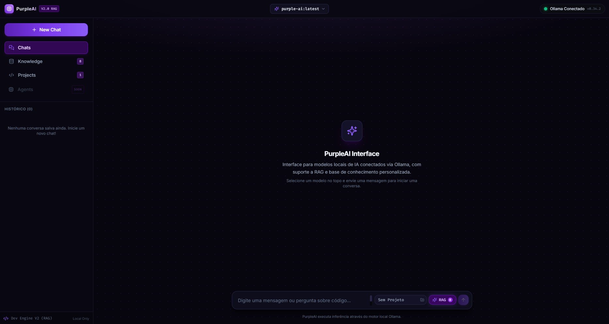
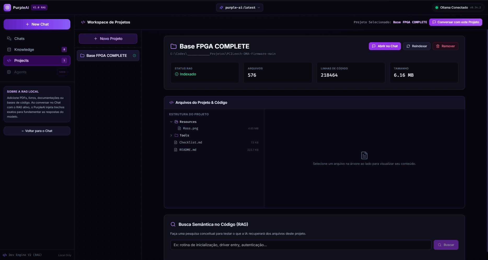
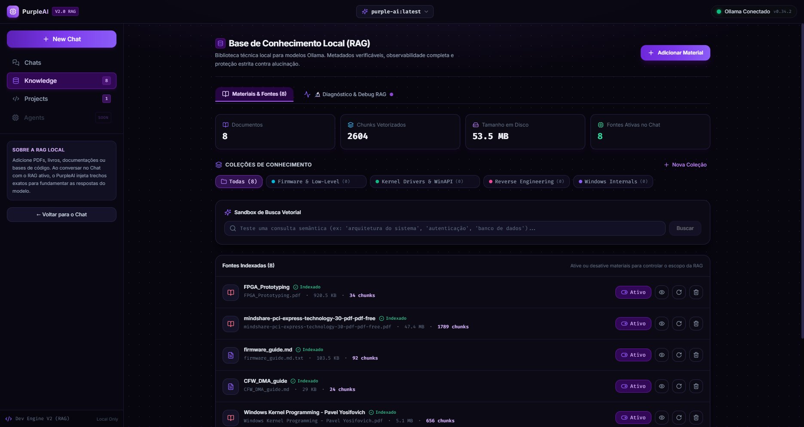

<div align="center">

# 🟣 PurpleAI Interface `v2.0`

### Your 100% Local, Privacy-First AI Copilot & Workspace — No Cloud, No Subscriptions
**Transform any local Ollama model (DeepSeek, Qwen Coder, Llama) into an intelligent workstation with Vector RAG and 1-Click Code Editing on Disk.**

🌐 **[ENGLISH VERSION]** • 🇧🇷 **[Versão em Português](README.md)**

[](LICENSE)
[](https://nodejs.org/)
[](https://ollama.com/)
[](https://react.dev/)
[](https://www.typescriptlang.org/)
[](https://vitejs.dev/)
[](https://tailwindcss.com/)

[🎯 Mission](#-project-mission) • [✨ Core Pillars](#-the-4-core-pillars) • [📸 Screenshots](#-screenshots) • [⚡ Features](#-complete-features) • [🚀 Quick Start](#-quick-start) • [🏗️ Architecture](#-system-architecture)

---

</div>

## 🎯 Project Mission

Most developer AI tools today (such as GitHub Copilot, Cursor, or ChatGPT) come with two fundamental drawbacks:

1. **Cloud Dependency & Privacy Risks**: Your proprietary codebase, secrets, and sensitive technical documentation are streamed to external third-party servers.
2. **Local UIs Trapped in "Chat Only" Mode**: Most web interfaces for Ollama act merely as generic text chats. They cannot inspect local repository trees, lack codebase awareness, and cannot actually modify files on your computer.

> 💡 **PurpleAI Interface was built to bridge this gap:**  
> Provide a modern, ultra-responsive, cyber-aesthetic developer workstation running **100% on your local hardware**. It enables you to chat with state-of-the-art local LLMs, query technical docs through local vector RAG, and **empower the AI to propose and apply code modifications directly to disk with 1 click and automatic safety backups (`.bak`)**.

---

## ✨ The 4 Core Pillars

| Pillar | Description |
| :--- | :--- |
| 💻 **Workspace & Code Agent** | Connect local directories from your machine. The AI explores your file tree, understands codebase context, suggests surgical patches (`SEARCH/REPLACE diff`) or entire files, and writes them to disk with 1 click (backed by automatic `.bak` safety backups and an integrated terminal). |
| 🧠 **Vector RAG Knowledge Base** | Ingest technical manuals, PDFs, books, and Markdown notes. The local vector engine chunks documents intelligently and retrieves relevant passages via fast cosine similarity, grounding model answers with real source citations and zero hallucination. |
| 📊 **Real-Time Context HUD Monitor** | Live Ollama token telemetry (`num_ctx` up to 16k tokens) rendered in a cyberpunk HUD progress bar. Track exact prompt, RAG, history, and completion consumption with dynamic color alerts (purple, amber, pulsing red) and smart memory pruning to prevent context overflow errors. |
| 🪟 **Widescreen Layout & Focus Mode** | Spacious layout (`max-w-[1550px]`) crafted for Full HD and Ultrawide displays. Code blocks take full width without artificial wrapping, and the sidebar can be smoothly collapsed from the header for distraction-free coding. |

---

## 📸 Screenshots

<div align="center">

### 💬 Streaming Local LLM Chat & Live Context HUD
*Token-by-token streaming, dynamic Ollama model selector, and live context window consumption bar:*



---

### 🛠️ Project Workspace & 1-Click Code Modification
*Interactive directory tree, syntax highlighted code viewer, and actionable cards to apply diffs or files directly to disk:*



---

### 🧠 Vector RAG Knowledge Base
*Technical document ingestion, intelligent paragraph chunking, and lightning-fast semantic vector search:*



</div>

---

## ⚡ Complete Features

- 🔒 **100% Local & Private**: Zero telemetry, zero external network calls. Everything runs exclusively on your local machine.
- ⚡ **Automatic Ollama Synchronization**: Automatically detects running Ollama instances and lists installed models (`llama3.2`, `qwen2.5-coder`, `deepseek-r1`, `mistral`, etc.).
- 🌊 **Real-Time Streaming (SSE)**: Fast, token-by-token streaming response with an instant "Stop" cancellation button.
- 📊 **Real-Time Context Monitor (HUD Progress Bar)**: Visual progress bar showing prompt, RAG, history, and completion tokens vs. maximum window capacity (`num_ctx`), with dynamic warning gradients and detailed tooltip breakdown.
- 🧹 **Smart Context Management & Pruning**: Graceful automatic pruning of older messages to prevent LLM memory overflows (`exceeds available context size`) plus a 1-click "Clear Context" button to reset memory.
- 💻 **Local Code Assistant & Project Workspace**:
  - Connect local directories by path on your machine.
  - Interactive file tree with embedded syntax highlighted code viewer.
  - Contextualizes your active project code directly in the system prompt.
  - **Interactive Diff & Patch Cards**: Surgical modification cards (`SEARCH/REPLACE diff`) or full file replacement with 1-click write to disk and automatic safety backup (`.bak`).
  - Integrated terminal drawer for running commands and builds directly inside the project root.
- 📚 **Built-in Vector RAG Engine**:
  - Ingestion for `.pdf`, `.md`, `.txt`, `.c`, `.cpp`, `.rs`, `.py`, `.ts`, and more.
  - Smart paragraph and code-aware chunking.
  - Local vector embeddings and cosine similarity search.
  - Interactive source citation modal in chat messages.
- 🪟 **Widescreen Layout & Collapsible Sidebar**: Generously expanded chat container (`max-w-[1550px]`) and full-width code blocks to eliminate artificial wrapping, with a header toggle button to collapse the sidebar for distraction-free coding.
- 🎨 **Rich Syntax Highlighting**: Powered by Highlight.js with dark cyber themes for C, C++, Assembly (MASM/NASM), Rust, Python, Go, TypeScript, JSON, Bash, and more.
- 💾 **Safe Atomic Storage**: Conversations, collections, and projects are persisted locally in lightweight JSON files.

---

## 🚀 Quick Start

### 1. Prerequisites
- [Node.js](https://nodejs.org/) v18 or higher installed.
- [Ollama](https://ollama.com/) installed and running locally.
- Pull your preferred models in terminal:
  ```bash
  # Recommended Chat model for code and reasoning
  ollama pull qwen2.5-coder
  # or
  ollama pull llama3.2

  # Recommended Embedding model for RAG
  ollama pull all-minilm
  ```

### 2. Clone Repository
```bash
git clone https://github.com/CodigoRoxo/PurpleAI-Interface.git
cd PurpleAI-Interface
```

### 3. Install Dependencies
```bash
npm install
```

### 4. Start the Application

#### Option A — 1 Click on Windows:
Double-click:
```cmd
start.bat
```

#### Option B — 1 Click on Linux / macOS:
```bash
chmod +x start.sh
./start.sh
```

#### Option C — Standard Terminal:
```bash
npm run dev
```

Open your browser at:  
👉 **[http://localhost:3000](http://localhost:3000)**

---

## 🛠️ Usage Modes

### 1. Basic Local LLM Chat
Select any model available in your local Ollama via the header dropdown. Send your query and watch responses stream in real time.

### 2. Technical Knowledge Base (RAG)
1. Go to the **Knowledge** tab in the sidebar.
2. Create a collection and upload documents (technical PDFs, manuals, notes).
3. Chat with the **RAG** toggle enabled; the assistant retrieves relevant excerpts and cites references directly.

### 3. Project Workspace (Code Assistant)
1. Open the **Projects** tab and click **New Project**.
2. Enter a project name and its absolute path on your disk (e.g., `E:\MyProjects\App`).
3. PurpleAI indexes files and builds a semantic vector database of your code.
4. In chat, select the project from the dropdown next to the RAG button (or click **"Chat with this Project"**).
5. Ask the AI to diagnose errors, explain architecture, or build new features.
6. When the AI proposes changes, click **"Apply Modification"** on the card to update the file on your disk!

---

## 🏗️ System Architecture

```text
┌────────────────────────────────────────┐         ┌────────────────────────────────────────┐
│         Frontend (React 18 + TS)       │         │        Backend (Express + Node.js)     │
│                                        │         │                                        │
│  - Widescreen Chat & SSE Streaming     │ ◄─────► │  - SSE Proxy & Ollama Orchestrator     │
│  - HUD Context Progress Monitor        │   SSE   │  - Safe Disk I/O & Automatic .bak      │
│  - FileActionCard (Interactive Diffs)  │   HTTP  │  - Vector Chunker & Cosine Search      │
│  - Projects Explorer & Terminal Drawer │         │  - Smart Context Pruning Engine        │
│  - Knowledge Manager & RAG Inspector   │         │  - Atomic JSON Data Storage            │
└────────────────────────────────────────┘         └───────────────────┬────────────────────┘
                                                                       │
                                                                       ▼
                                                   ┌────────────────────────────────────────┐
                                                   │          Ollama Local Engine           │
                                                   │         (http://localhost:11434)       │
                                                   │                                        │
                                                   │  - Chat LLMs (Qwen, DeepSeek, Llama)   │
                                                   │  - Embeddings (all-minilm, bge, etc.)  │
                                                   └────────────────────────────────────────┘
```

---

## ⚙️ Environment Variables (Optional)

To customize default ports or Ollama URLs, create a `.env` file inside `backend/`:

```env
PORT=3001
HOST=127.0.0.1
OLLAMA_HOST=http://localhost:11434
EMBEDDING_MODEL=all-minilm
OLLAMA_NUM_CTX=16384
```

### 🔒 Security

The backend reads and writes files in your projects and can run terminal commands, so it ships locked down:

- Listens on `127.0.0.1` only (not visible on your network).
- Accepts requests only from the frontend (`ALLOWED_ORIGINS`) with a local `Host` header, which blocks malicious websites and DNS rebinding attacks.
- Files can only be read/written inside the project folder (never inside `.git`), and the drive root or your home folder can't be added as a project.

To reach it from another machine, you **must** set a token (the backend refuses to start without one). The Vite proxy sends it automatically:

```env
HOST=0.0.0.0
PURPLEAI_API_TOKEN=a-long-random-secret
ALLOWED_ORIGINS=http://192.168.0.10:3000
# Terminal commands are off outside loopback; enable only on a network you trust
ALLOW_SHELL_COMMANDS=false
```

---

## 🤝 Contributing

Contributions are very welcome! Feel free to open an **Issue** or submit a **Pull Request** with bug fixes, performance optimizations, or new capabilities.

---

## 📄 License

Distributed under the **MIT** License. See [LICENSE](LICENSE) for details.
